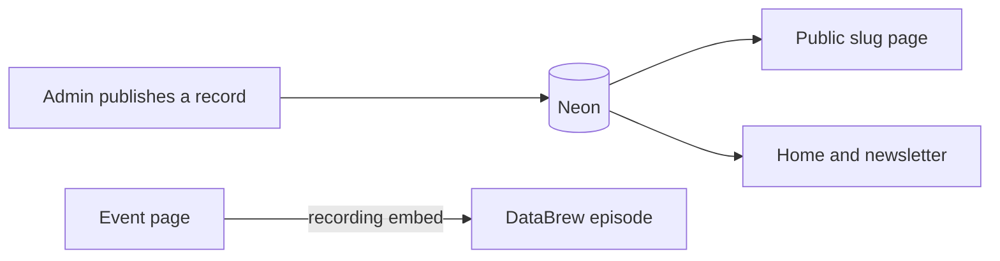

# DataBiz — Application specification

Status: build spec for the new DataBiz site. This document is the product and technical source of truth. It does not ship application code.

The public site today is [databiz.in](https://www.databiz.in/). This spec replaces that app with one Next.js system. Content that already exists on the live site is called out in [Seed content](#16-seed-content) so it can be republished.

## 1. Society

DataBiz is the official Data Science and Analytics Club of NIT Bhopal (Maulana Azad National Institute of Technology, MANIT).

Students run it for students who want to learn data science, machine learning, and artificial intelligence, from fundamentals through applied work. The about page states the mission in one line: make data useful, understandable, and human. The goal is that every member can tell a true story with data, and use that skill with care.

What the society actually does, taken from the live site:

- Learning pathways in data, machine learning, and AI
- Workshops, hackathons, and networking events
- Industry talks with practitioners
- Student projects
- Writing, published as the blog
- The DataBrew Show, an interview series. Episode material already on the site features Rishabh Chhabra (Consultant, World Bank Group; ex-Deloitte India, Audit), held online on Zoom

Core values published on the about page:

1. Learn by doing. Sessions and projects apply concepts to real problems.
2. Community first. Confidence comes from working with peers.
3. Think across disciplines. Data connects to economics, healthcare, the environment, and other fields.
4. Create responsible impact. Use data for work that is socially careful.

How the society describes its approach: learning by doing, community driven, industry ready, innovation first.

Identity to preserve in the product:

| Fact | Value |
|---|---|
| Name | DataBiz |
| Line | Data Science & Analytics Club |
| College | NIT Bhopal — MANIT |
| Email | databiz.nitb@gmail.com |
| LinkedIn | https://www.linkedin.com/company/databiz-nitb/ |
| Instagram | https://www.instagram.com/databiz_nitb |
| Domain | https://www.databiz.in |

The live footer also links to X, a learning path, a newsletter, community guidelines, an FAQ, a privacy policy, and terms. Those footer links currently go nowhere (`#`). This app makes each of them a real page. The X profile is left blank until the core supplies a URL.

## 2. Product goals

A visitor can understand DataBiz, read the work, and take the next step: an event, a pathway, a post, the show, or an open drive.

A MANIT student can sign in with a college address, apply through a three-phase drive, register for events, and track pathway modules.

A core member can publish every public page, score hiring, and export lists without a developer.

The homepage blocks that are hardcoded or empty on the current site become queries:

- Recruiting state comes from an open drive
- Recent blogs come from published posts
- Upcoming events come from published events whose end time is still in the future
- The latest DataBrew episode comes from the latest published episode

## 3. Stack

| Layer | Choice | Owns |
|---|---|---|
| App | Next.js App Router, TypeScript | Routes, server actions, route handlers, preview |
| UI | Tailwind CSS | Layout and styling |
| Database | Neon Postgres | All structured data |
| Data access | Drizzle ORM and `@neondatabase/serverless` | Schema, queries, SQL migrations |
| Media | Cloudinary | Posters, covers, photos, avatars, brochure PDF, resumes, OA files |
| Email | Resend | Magic links, hiring mail, event mail, contact, alumni queue, newsletter |
| Auth | Better Auth | Magic links, sessions, and the user row in Neon |
| Validation | Zod | Every server-action input |
| Host | Vercel | Production, preview deployments, daily cron |

Episode audio and video stay on YouTube or Spotify. The site stores an embed URL and a cover image.

```text
DATABASE_URL=
BETTER_AUTH_SECRET=
BETTER_AUTH_URL=
CLOUDINARY_CLOUD_NAME=
CLOUDINARY_API_KEY=
CLOUDINARY_API_SECRET=
RESEND_API_KEY=
EMAIL_FROM=
CONTACT_INBOX=databiz.nitb@gmail.com
NEXT_PUBLIC_APP_URL=
ALLOWED_EMAIL_DOMAIN=stu.manit.ac.in
CRON_SECRET=
```

`DATABASE_URL`, `BETTER_AUTH_SECRET`, `CLOUDINARY_API_SECRET`, `RESEND_API_KEY`, and `CRON_SECRET` are server-only.

## 4. Sign-in and roles

### 4.1 Who can sign in

Sign-in is a Better Auth magic link sent through Resend. The server sends a link only when all of these hold:

- The address has one `@`
- The domain is `stu.manit.ac.in`, compared case-insensitively
- The local part is non-empty and contains no `+`

Example that passes: `26230051126@stu.manit.ac.in`.

The local part is stored as `roll_number`. The account exists only after the person opens the link, so typing someone else's roll number does not create a session.

A new user gets role `applicant`. An admin changes roles. There is no public self-serve signup for any other domain. Alumni and guests do not get accounts. They use public forms.

### 4.2 Roles

`visitor` means "no session". It is not stored on the user row.

| Role | Can do |
|---|---|
| Visitor | Read published pages. Register for a public event. Send the contact form, the newsletter form, and an alumni update. |
| Applicant | Edit own year, branch, and phone. Submit one application per drive. Sit that role's OA. Book one interview slot after shortlist. See own stage and deadlines. Register for events. |
| Member | Everything an applicant can do, plus the member directory and member resources. Mark pathway modules complete. |
| Interviewer | Open only the applicants assigned to them. Submit one scorecard per assigned applicant. |
| Admin | Create and publish content. Approve alumni. Run drives. Assign interviewers. Export lists. Change roles. Send a newsletter. |

An interviewer who is also on the core is an admin, and uses admin for publishing. The interviewer permission is what limits candidate visibility during a drive.

### 4.3 Rules that apply everywhere

- Every create, update, delete, score, and export checks the session role on the server. Hiding a control in the UI is not the check.
- A user reads their own application, attempt, bookings, and registrations. They do not read other applicants' rows, answer keys, numeric scores, or interviewer notes.
- Drafts are visible in admin and on admin preview routes. The public route returns 404 for a draft.
- Lists that power the public site filter `status = published` (or `past` for events that have happened).

## 5. How a page comes into existence

An event, post, project, episode, drive, pathway, or alumni profile is one database row. One template renders every row of that type. Publishing writes a slug and makes `/<section>/<slug>` public.

Other pages store the row's id. The homepage "next event", an announcement, a post, and a DataBrew episode point at an event. They do not copy its title, time, or venue. Editing the event updates every place that references it.

Slug rules:

- On first publish, an empty slug is generated from the title: lowercase, ASCII, hyphenated, unique inside that table.
- After publish, the slug does not follow title edits.
- An admin can set a new slug on purpose. That insert writes a row in `redirects` from the old path to the new path. The app responds with a permanent redirect.



Preview is an admin route, `/admin/preview/<type>/<id>`, which renders the public template with draft data. It requires an admin session.

## 6. Routes

### Public

```text
/                          Home
/about                     Mission, values, approach
/team                      Current core
/work                      Project list
/work/[slug]               Project
/events                    Upcoming and past
/events/[slug]             Event
/blog                      Posts
/blog/[slug]               Post
/show                      The DataBrew Show
/show/[slug]               Episode
/learn                     Pathways
/learn/[slug]              One pathway
/alumni                    Published alumni
/join                      Open drive, or a closed notice
/join/[slug]               Drive and apply
/sponsors                  Sponsor the society
/announcements             Notices
/faq                       FAQ
/guidelines                Community guidelines
/privacy                   Privacy policy
/terms                     Terms of service
/contact                   Contact form
```

### Account

```text
/login                     Request a magic link
/account                   Profile, application, registrations, pathway progress
```

### Admin

```text
/admin                         Counts: open drive, upcoming events, pending alumni
/admin/events                  Drive the event lifecycle
/admin/events/[id]
/admin/posts
/admin/posts/[id]
/admin/show
/admin/show/[id]
/admin/projects
/admin/team
/admin/alumni                  Approve or edit profiles
/admin/learn
/admin/drives
/admin/drives/[id]             Roles, OA, shortlist, slots, results, export
/admin/announcements
/admin/sponsors
/admin/pages                   FAQ, guidelines, privacy, terms
/admin/newsletter
/admin/resources
/admin/users                   Change roles
```

`/blog` is the canonical list. The current site uses both `/blogs` and `/blog`. The new app serves `/blog` and permanently redirects `/blogs` and `/blogs/:id` only if a matching legacy map is added later. New URLs use slugs, not the Mongo-style ids on the current site.

## 7. Features

### 7.1 Home

The home page is assembled from live records.

- Hero: "DataBiz", "Data Science & Analytics Club", and the line "Empowering the next generation through collaborative learning, industry insights, and hands-on projects at NIT Bhopal."
- Primary actions: explore events, read the blog, open pathways. If a drive has `status = open` and the current time is inside its window, show "Recruiting" and a link to `/join/[slug]`. If none is open, omit the recruiting block.
- Next event: the published event with the soonest `starts_at` still in the future. Empty state: "No upcoming events right now", linking to past events.
- Latest post: most recently published post. Empty state points at `/blog`.
- Latest DataBrew episode, if any.
- Three pathways, if published.
- Contact strip: email, MANIT location, LinkedIn, Instagram.

### 7.2 About

A published page, editable by admins, seeded with the copy already on databiz.in:

- Who we are: official club; students turning raw data into insights; DS, ML, and AI from fundamentals to advanced applications.
- Three steps: learning pathways, workshops and hackathons, student projects.
- Mission: make data useful, understandable, and human. Members become storytellers through data and use that knowledge with care.
- Four values and the four-part approach from section 1.

Links from this page go to `/learn`, `/events`, `/blog`, and `/team`.

### 7.3 Team

Public `/team` lists `team_members` where `is_current` is true, ordered by `sort_order`. Each card has name, role title, photo, and a short bio.

The current site's "Meet the team" entry does not render a public roster (requesting `/team` lands on login). This app publishes the roster. Admins maintain it. A person can appear on the team without being a login user. If they are also a user, `user_id` links them so a blog post can name that author.

### 7.4 Projects

`/work` is how the society shows "all its work" beyond events and posts.

A project has title, slug, summary, markdown body, cover, year, and a list of links (label plus URL: demo, repo, write-up). Only published projects appear. The home page does not have to list every project. `/work` does.

### 7.5 Events

An event is a workshop, hackathon, talk, networking session, or a live DataBrew recording.

**Fields:** title, slug, summary, markdown body, poster, venue, meeting URL, start, end, capacity (null means unlimited), RSVP deadline, status (`draft`, `published`, `past`), recap markdown, recording URL, template (`default` or `fest`).

**What the public page shows**

| Status and time | Page |
|---|---|
| Draft | Public URL 404s. Admins use the preview route. |
| Published, and `ends_at` is in the future, before the RSVP deadline, under capacity | Details plus RSVP |
| Published, RSVP deadline passed or capacity reached | Details, RSVP closed |
| Published, and now is between start and end | Details plus venue or meeting link |
| Past | Recap, gallery, and recording URL on the same path, with the original details still visible |

`/events` splits into Upcoming (`published` and `ends_at` in the future) and Past (`past`, newest first). Counts of each are shown, matching the current events page.

**RSVP.** One registration per email per event. Fields: first name, last name, email, year, branch. A signed-in student has these filled from the profile and may edit them for this registration. Status is `registered`, `attended`, or `cancelled`. Capacity counts rows in `registered`. Cancelling frees a seat.

**After the event.** An admin marks the event `past`, writes the recap, attaches gallery photos, and can set `recording_url`. If this event is a DataBrew session, they also create or link an episode (section 7.6). The shared URL does not change.

**Fest template.** `template = fest` adds an ordered schedule (title, start, end, speaker, place) and a set of sponsor ids. Same route. Same RSVP rules.

**Check-in.** On the admin event screen, each registration can be marked `attended`.

**Reminder.** A daily Vercel cron, authorized with `CRON_SECRET`, finds published events whose start falls on the next calendar day in `Asia/Kolkata` and whose `reminder_sent_at` is null. It emails every `registered` address and then sets `reminder_sent_at`.

### 7.6 The DataBrew Show

DataBrew is DataBiz's interview series. It is not a generic podcast library with files hosted by the site.

**Episode fields:** title, slug, summary, markdown show notes, cover, publish time, status, provider (`youtube`, `spotify`, or `other`), embed URL, "open on the platform" URL, optional `event_id`.

**Guests:** name, title, organization, photo, order. The seed episode's guest is Rishabh Chhabra, Consultant at the World Bank Group, previously Deloitte India (Audit).

**Pages.** `/show` lists published episodes, newest first. `/show/[slug]` renders the cover, notes, guests, and the platform embed. Subscribe links go to the show's YouTube or Spotify page, stored as site settings once the core has those URLs.

**How a session becomes an episode.**

1. Admin publishes an event with the Zoom (or other) link. Students RSVP on `/events/[slug]`.
2. After the session, admin marks the event past and writes the recap.
3. Admin creates an episode, sets `event_id` to that event, and pastes the YouTube or Spotify embed.
4. The event page links to the episode. The episode page links back to the event.

An episode may also be published with no event, for a recording that was never an RSVP session.

Cloudinary stores the cover only. The media file stays on the host named in `provider`. This app does not generate an Apple Podcasts or Spotify RSS enclosure, because an enclosure needs a direct audio file.

### 7.7 Blog

**Fields:** title, slug, excerpt, markdown body, cover, author (`team_members.id`), tags, status, published time, and optional ids for an event, a project, and an episode.

`/blog` lists published posts, newest first, with title, excerpt, author, date, and a reading time computed from the word count (about 200 words per minute). `/blog/[slug]` is the article. The byline is the team member's name.

Comments are out of scope. Admins write and publish. A post can mention an event, project, or episode by reference. The article page renders those as links with the current title of the target.

### 7.8 Alumni

Alumni are public profiles the core publishes. Sign-in stays on `@stu.manit.ac.in`, which many graduates no longer have, so alumni do not get accounts.

**Fields:** name, slug, batch (the graduating or pass-out year the core uses), branch, role they held in DataBiz, current title, organization, LinkedIn URL, photo, short note, status (`pending` or `published`), sort order.

`/alumni` lists `published` profiles and can filter by batch.

Two ways a row appears:

- An admin creates it as `published`.
- Anyone submits the public form: name, batch, branch, society role, current title, organization, LinkedIn. The insert is `pending`. Resend emails `CONTACT_INBOX`. An admin edits and publishes, or deletes. Pending rows are invisible on `/alumni`.

### 7.9 Learning pathways

The about page leads with pathways. The current footer link is a dead `#`. This app publishes real pathways without becoming a course platform.

A pathway has title, slug, summary, discipline (`data`, `ml`, `ai`, or `other`), status, and order.

A module has title, a short description, an external URL, and order. Modules are links to readings, playlists, or problem sets the core trusts. The app does not host video lessons, grade quizzes, or issue certificates.

`/learn` lists published pathways. `/learn/[slug]` lists modules in order. A signed-in member (and admin) can mark a module complete. Completion is stored per user and module. Applicants and visitors see the links and do not get progress toggles. Progress is private to that user and to admins.

### 7.10 Hiring

One drive is one recruitment cycle. It has title, slug, markdown description, `opens_at`, `closes_at`, and status (`draft`, `open`, `closed`).

A drive has one or more roles (for example technical, design, content, operations). Each role has its own OA mode.

An application belongs to one user, one drive, and one role. A user can submit one application per drive. The role is locked once the OA attempt has started.

**Stages**

```text
applied → oa → shortlisted → interview → selected | waitlisted | rejected
selected → accepted | declined
```

The applicant sees the stage, the relevant deadline, and their interview slot. They do not see scores, keys, or notes.

**Apply.** Required profile fields first: name, year, branch. Then role, resume PDF, and an optional portfolio URL. On submit the stage is `applied` and the applicant gets one email. If the drive is not `open`, or now is outside the window, submit fails.

**Phase 1 — online assessment.** Admin moves a cohort (or one person) to `oa`, which sends one email. The mode is set per role:

| Mode | Behavior |
|---|---|
| `quiz` | One attempt. The applicant may start any time before the role's OA deadline. A timer of `quiz_minutes` starts at that moment. Auto-submit when the timer ends or the deadline arrives, whichever is first. |
| `upload` | One private file, or the resume already on the application if the role says so. Manual score. Deadline is the role OA deadline. |
| `quiz_and_upload` | Both, on the same attempt. |
| `live_quiz` | Questions are not sent to the client before `live_starts_at`. Answers lock at `live_ends_at`. One attempt for everyone in that window. |

Question kinds: multiple choice, short text, long text. Multiple choice with a stored key is scored on the server. Short and long text wait for a manual point award. The key never leaves the server. A live quiz response before `live_starts_at` returns no questions. A response after `live_ends_at` is rejected.

This is a timed society round. It does not claim to be a proctored exam.

**Shortlist.** Admin sorts by auto-score and manual score, then sets stage to `shortlisted`, `waitlisted`, or `rejected`. Shortlist and rejection send mail. Waitlist at this step does not send mail until a later result publish, so people are not told they are waiting before interviews exist. Admin can still see the waitlist internally.

**Phase 2 — interview.** Admin creates slots (start, end, capacity) on the drive. A shortlisted applicant books one slot that still has room. One booking per application. Booking emails the applicant and every interviewer assigned to that application.

Admin assigns interviewers per application. An interviewer opens only those people. The scorecard is a rubric of named criteria, each scored 1–5, plus notes and a recommendation (`yes`, `no`, `maybe`). One scorecard per interviewer per application. The applicant never sees it.

**Phase 3 — result.** Admin sets `selected`, `waitlisted`, or `rejected` and publishes results. That publish is what sends the result email and flips the stage the applicant can see. A selected applicant accepts or declines on `/account`.

Decline sets the stage to `declined` and shows the admin the earliest `waitlisted` application for the same role. Promotion is a button the admin confirms. Confirming sets that application to `selected` and sends the selected email.

**Export.** CSV of name, roll number, email, year, branch, role, stage. Admin only.

### 7.11 Newsletter

The footer form on the current site becomes a real list.

- The visitor enters an email. Any email domain is allowed here. This is not the sign-in domain.
- The server stores `pending` and sends a confirm link with Resend.
- Opening the link sets `confirmed`.
- A second subscribe on an existing confirmed address does nothing visible beyond "You are already subscribed."
- Each message has an unsubscribe link that sets `unsubscribed`.

An admin can send a message to all `confirmed` addresses when they publish an event, a post, or open a drive. The admin screen has the draft subject and body, a recipient count, and a send button. Sends are logged so the same publish does not mail twice unless the admin deliberately sends again.

Day-before event reminders go to registrants, not to the whole newsletter list.

### 7.12 Sponsors

`/sponsors` is the current "Sponsor us" page, with a working brochure.

- Page copy: partnership with DataBiz, aimed at organizations that want to support students in data and analytics.
- A PDF brochure stored in Cloudinary. The button downloads that file.
- Contact path: `databiz.nitb@gmail.com`, plus LinkedIn and Instagram.
- Logos of current sponsors, if any, from the `sponsors` table. An empty logo list hides the logo row.

The fest template reuses these sponsor rows.

### 7.13 Announcements

Short notices. Fields: title, markdown body, status, published time, and at most one reference among event, post, drive, and episode.

`/announcements` lists published notices, newest first. The home page may show the latest one. Publishing a notice does not by itself send the newsletter. The admin can choose to send, using the newsletter tool.

### 7.14 Contact

Fields match the live form: first name, last name, email, message. All four are required. Submit stores the row and emails `CONTACT_INBOX` through Resend. The sender's address is the reply-to. The visitor sees a confirmation on the page.

### 7.15 FAQ, guidelines, privacy, terms

Each is an admin-edited markdown document in `site_pages`, keyed by slug: `faq`, `guidelines`, `privacy`, `terms`.

The FAQ page renders question-and-answer blocks if the admin uses the `faq_items` table. If that table is empty, it falls back to the markdown body. Seed the FAQ with at least:

- Who can join DataBiz? MANIT students sign in with `@stu.manit.ac.in` and apply while a drive is open.
- What does the club do? Pathways, workshops, hackathons, talks, projects, the blog, and The DataBrew Show.
- How do events work? Each event has its own page. Register on that page.
- How does hiring work? Online assessment, interview, then a result on `/account`.

Guidelines, privacy, and terms ship as short starter documents an admin can replace:

- Guidelines: be respectful, give credit, do not share someone else's application or resume, use data work with care.
- Privacy: what the site stores (college email, roll number, year, branch, resume, RSVP details, newsletter address) and that hiring data is visible to admins and assigned interviewers.
- Terms: the site is a student-society service, content is published by DataBiz, and accounts are for MANIT students.

### 7.16 Member resources

Links or files for role `member` and above: title, description, and either a URL or a private Cloudinary file. Invisible to visitors and applicants. Listed on `/account`.

### 7.17 Account

`/account` shows:

- Profile: name, email, roll number (read-only), year, branch, phone
- Current application: drive, role, stage, OA deadline or live window, interview slot, accept or decline if `selected`
- Event registrations
- Pathway progress, for members and admins

## 8. Admin

Admins need no code to run a semester. The admin home shows: drives currently open, events in the next 14 days, alumni rows in `pending`, and newsletter subscriber count.

Each content section supports create, edit, preview, publish, and unpublish (back to draft). Unpublish removes the page from public lists and makes the public URL 404. It does not delete the row.

Drive admin, on one screen per drive:

- Window and description
- Roles and OA mode
- Questions and keys
- Applications with scores
- Stage changes
- Slots, bookings, interviewer assignment
- Scorecards
- Result publish
- CSV export

User admin lists users and sets `applicant`, `member`, `interviewer`, or `admin`. An admin cannot remove their own admin role if they are the only admin.

## 9. Data model

Ids are UUIDs. Timestamps are `timestamptz`. Slugs are unique per table. Foreign keys cascade only where the child is meaningless without the parent (photos, modules, questions, guests). Applications, registrations, and posts restrict deletes of their parent while child rows exist. Admins unpublish instead of deleting history.

Better Auth owns `user`, `session`, `account`, and `verification`. Extend `user` with:

| Column | Notes |
|---|---|
| roll_number | Local part of the college email. Unique. |
| year | Text, nullable until they apply. |
| branch | Text, nullable until they apply. |
| phone | Text, nullable. |
| role | `applicant` by default. Also `member`, `interviewer`, `admin`. |

Application tables:

| Table | Important columns |
|---|---|
| events | slug, title, summary, body, poster_public_id, venue, meeting_url, starts_at, ends_at, capacity, rsvp_deadline, status, recap_body, recording_url, template, reminder_sent_at, published_at |
| event_registrations | event_id, user_id nullable, first_name, last_name, email, year, branch, status. Unique (event_id, email) |
| event_photos | event_id, public_id, caption, sort_order |
| event_schedule_items | event_id, title, starts_at, ends_at, speaker, place, sort_order |
| event_sponsors | event_id, sponsor_id |
| posts | slug, title, excerpt, body, cover_public_id, author_id, tags, status, published_at, event_id, project_id, episode_id |
| projects | slug, title, summary, body, cover_public_id, year, links jsonb, status, published_at |
| team_members | name, role_title, bio, photo_public_id, sort_order, is_current, year_label, user_id nullable |
| alumni_profiles | slug, name, batch, branch, society_role, current_title, organization, linkedin_url, photo_public_id, note, status, sort_order |
| episodes | slug, title, summary, show_notes, cover_public_id, status, published_at, provider, embed_url, external_url, event_id nullable |
| episode_guests | episode_id, name, title, organization, photo_public_id, sort_order |
| pathways | slug, title, summary, discipline, status, sort_order |
| pathway_modules | pathway_id, title, description, url, sort_order |
| pathway_progress | user_id, module_id, completed_at. Primary key (user_id, module_id) |
| drives | slug, title, description, opens_at, closes_at, status |
| drive_roles | drive_id, name, description, oa_mode, oa_deadline, live_starts_at, live_ends_at, quiz_minutes |
| applications | drive_id, role_id, user_id, resume_public_id, portfolio_url, stage. Unique (drive_id, user_id) |
| oa_questions | role_id, prompt, kind, options jsonb, answer_key, points, sort_order |
| oa_attempts | application_id unique, started_at, submitted_at, auto_score, manual_score, upload_public_id, status |
| oa_answers | attempt_id, question_id, response, awarded_points. Unique (attempt_id, question_id) |
| interview_slots | drive_id, starts_at, ends_at, capacity |
| interview_bookings | slot_id, application_id unique |
| interview_assignments | application_id, interviewer_id. Primary key both columns |
| scorecards | application_id, interviewer_id, rubric jsonb, notes, recommendation, submitted_at. Unique (application_id, interviewer_id) |
| announcements | title, body, status, published_at, event_id, post_id, drive_id, episode_id |
| sponsors | name, logo_public_id, url, blurb, sort_order |
| site_pages | slug primary key, title, body, updated_at |
| faq_items | question, answer, sort_order, published |
| subscribers | email unique, status, confirm_token, confirmed_at, unsubscribed_at |
| newsletter_sends | subject, body, sent_at, recipient_count, source_type, source_id |
| resources | title, description, url, public_id, sort_order |
| contact_messages | first_name, last_name, email, message, created_at |
| redirects | from_path unique, to_path |
| site_settings | key primary key, value. Used for show subscribe URLs and the brochure `public_id` |

`answer_key` is excluded from every query that returns questions to a browser. Scoring runs in a server action that reads the key and writes `awarded_points`.

## 10. Cloudinary

The browser requests a signature from a server action, then uploads directly to Cloudinary. The database stores `public_id`, not the file bytes.

| Folder | Use | Access |
|---|---|---|
| `posters/` | Event posters, project covers | Public image |
| `blog/` | Post covers | Public image |
| `show/` | Episode covers | Public image |
| `gallery/` | Event photos | Public image |
| `avatars/` | Team, guests, alumni | Public image |
| `sponsors/` | Logos and the brochure PDF | Public |
| `resumes/` | Resumes and OA uploads | Authenticated delivery |

Limits: images 5 MB; resumes, OA files, and the brochure 20 MB; resumes and OA files are PDF only. The signature action checks the caller's role. Resumes require a signed-in applicant uploading their own file, or an admin. Public pages never receive a permanent URL for a resume.

The live site already serves at least one poster from Cloudinary cloud `dvil2pqgj`. The new app uses the cloud named in `CLOUDINARY_CLOUD_NAME`. Seed images are re-uploaded there. The spec does not depend on credentials for the old cloud.

## 11. Email

All mail is sent from the server with Resend. `EMAIL_FROM` is the from-address. `CONTACT_INBOX` receives contact and alumni mail.

| Trigger | Recipient |
|---|---|
| Magic link requested | That student, only after the domain check |
| Application submitted | Applicant |
| Stage set to `oa`, `shortlisted`, `interview` | Applicant |
| Result published (`selected`, `waitlisted`, `rejected`) | That applicant |
| Waitlisted applicant promoted after a decline | That applicant |
| Interview booked | Applicant and assigned interviewers |
| Event registration saved | Registrant |
| Event reminder, one day before | Registrations still `registered` |
| Contact form | `CONTACT_INBOX`, reply-to the sender |
| Alumni form | `CONTACT_INBOX` |
| Newsletter confirm | That address |
| Newsletter send | Confirmed subscribers |

`/account` remains correct if a message is missed. Stage and registration status are read from Neon, not from the inbox.

Newsletter and reminder jobs record a send row or `reminder_sent_at` before retrying, and a retry must not double-send. If Resend fails, the admin sees the failed send and can run it again.

## 12. Pages the public site already promised

These exist on databiz.in only as links or thin pages. The corresponding section above is the behavior to build.

| Live surface | In this app |
|---|---|
| Home, about, events, event detail, blogs, login | Sections 7.1–7.5, 7.7, 4 |
| Sponsor us and "Download brochure" | Section 7.12 |
| Meet the team | Section 7.3, public |
| Learning path, newsletter, guidelines, FAQ, privacy, terms | Sections 7.9, 7.11, 7.15 |
| Recruiting badge | Open drive on the home page |
| Contact form and society email | Section 7.14 |
| The DataBrew Show event | Event plus episode, section 7.6 |

## 13. Security

- College-domain check happens before a magic link is sent and again when the link is consumed.
- Server actions parse input with Zod and then check the role.
- Resume and OA URLs are authenticated Cloudinary URLs minted for an admin or the owning applicant. They expire.
- OA keys and scorecards are not props on public or applicant pages.
- Cron requests must present `CRON_SECRET`.
- Preview routes require an admin session.
- Rate-limit magic-link requests, contact, alumni submit, newsletter subscribe, and RSVP by IP plus email, enough to stop a script filling the inbox. A simple per-route limit in the server action is enough for v1.

## 14. Build order

1. Next.js app, Tailwind, Drizzle, Neon, Better Auth, `@stu.manit.ac.in` magic link, admin shell with role checks.
2. Public shell: home, about, team, work, contact, and the four policy pages, with seed copy.
3. Events: schema, admin publish, `/events/[slug]`, RSVP, past recap on the same URL.
4. Cloudinary signed upload, used first by event posters.
5. Blog, then alumni list and the approval queue.
6. Pathways and pathway progress.
7. Drives end to end: apply, quiz, upload, live quiz, shortlist, slots, scorecards, result, export.
8. DataBrew episode pages and the link to an event.
9. Resend for the triggers in section 11, newsletter confirm and send, then the reminder cron.
10. Announcements, gallery, sponsors and brochure, member resources.
11. Seed the existing article and DataBrew session (section 16).

## 15. Out of scope

- Payments, tickets, and merchandise
- Certificates
- Comments on posts or episodes
- A full course platform: hosted lessons, graded pathway quizzes, cohorts
- Uploading podcast media to Cloudinary
- An Apple Podcasts or Spotify RSS enclosure feed
- A mobile app
- Alumni accounts and any sign-in domain besides `stu.manit.ac.in`
- Proctoring, webcam monitoring, or a lockdown browser for the OA

## 16. Seed content

Republish what is already public. Do not invent a team roster, sponsors, or extra posts.

**Blog**

- Title: Quantum Machine Learning: Is It Ready for Real World Data?
- Author name: Debashish (create a team member row if they are not already on the core list; `is_current` can be false)
- Slug: `quantum-machine-learning-real-world-data`
- Source: `https://www.databiz.in/blogs/6962b5113c528f3442e5e8d4`
- The live list shows 10 January 2026 and a 4 minute read. The article page shows 9 November 2026. Use 10 January 2026 as `published_at` unless the core says otherwise, and paste the body from the live article when seeding. The spec file does not duplicate the article.

**Event and show**

- Title: The DataBrew Show with Consultant
- Slug: `the-databrew-show-with-consultant`
- When: 21 February 2026, online, platform Zoom
- Guest: Rishabh Chhabra, Consultant, World Bank Group; ex-Deloitte India (Audit)
- Status: `past`
- Summary: the session covers what Big 4 audit teaches about thinking at scale, how finance, research, and analytics meet in global consulting, what it takes to reach institutions like the World Bank Group, and the shift from compliance to impact
- Poster: re-upload the image currently at `https://res.cloudinary.com/dvil2pqgj/image/upload/v1771598566/databiz/xvnlv5c26zw1skfccmzn.jpg`
- Episode: create a DataBrew episode linked to this event. Leave `embed_url` empty until the core pastes a YouTube or Spotify recording. The event page can still show the recap.

**Site**

- About copy from section 1 and the live about page
- Contact inbox `databiz.nitb@gmail.com`
- FAQ seeds from section 7.15
- Sponsor page with email and socials. Brochure file added when the core uploads the PDF they already offer as "Download brochure"

## 17. Done when

A core member can, without a developer:

- Publish an event and share `/events/<slug>` before it happens
- Take RSVPs, mark the event past, and add a recap on that same URL
- Attach a DataBrew episode embed to that event
- Publish a post, a project, a pathway, and an alumni profile
- Open a drive, run quiz or upload or a live quiz, interview with scorecards, and publish results
- Mail registrants the day before an event, and mail confirmed subscribers when something is published

A MANIT student can sign in only with `@stu.manit.ac.in`, apply once per drive, see their own stage, and register for an event.

A visitor who never signs in can read the society, the work, the blog, the show, alumni, and pathways, and can send the contact form.
